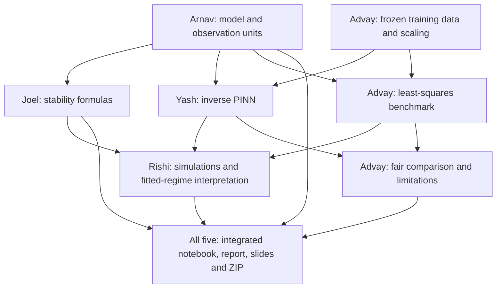

# Repository audit and remaining team work

**Historical audit:** superseded for current implementation status by
[the 28 October completion record](completion_status_2026-10-28.md).

Audited 27 October 2026 against GitHub/main revision
`28dbe1e2a611719f3d65e5922db528ae423724f2`, including Arnav's latest observation-model
follow-up. This is a status audit and proposed completion checklist, not approval
recorded on behalf of any teammate. Existing scientific code/results were not changed.

## Main finding

The core numerical and inference code works, and Yash's technical PINN deliverables
exist. The complete five-person submission is not assembled or fully reproducible yet.
Passing unit tests does not establish that all notebooks, reports, slides and packaging
have been integrated. Advay's screenshot is a phase-1 decision list that predates the
historical fits; several questions now have implemented answers, although the team's
notes still contain disagreements and proposed-status wording.

All three existing PRs have been merged. The connector returned no discussion/review
comments on PRs #1-#3 and no repository issues. The important teammate comments are in
the handoff documents, including Arnav's new follow-up. No claim is made about messages
outside GitHub or the files supplied to this chat.

## Evidence checked

- Re-read the original work distribution DOCX and compared its five roles and final
  deliverables with the tracked repository contents.
- Fetched current main and inspected Arnav's new commit, PR discussion timelines,
  all five relevant handoffs, source/configuration/dependency files and report entry points.
- Ran the complete current test suite: **42 passed**.
- Ran `scripts/verify_historical_outputs.py`: 13 PINN runs, three selected baseline
  variants, all 16 scored forecast files, source/output hashes, training-only seed
  selection and independent ODE/metric reconstruction passed. The historical notebook
  has eight executed code cells with no recorded errors.
- Ran `scripts/verify_outputs.py`: the 13 synthetic runs, source hashes, forecasts,
  metrics and 15 executed notebook code cells passed.
- Exercised the existing submission payload audit without writing a new ZIP: it fails
  because 12 distinct `ReportGraphEPS` references are found but exactly seven are required.
- Checked the declared project environment and requirements: pandas is unavailable and
  undeclared, while Rishi's notebook imports it.
- Rechecked the phase-portrait arrow formula against the actual shared RHS.

## Answers to Advay's four questions

| Question | Current implemented answer | Reconciliation still needed |
|---|---|---|
| Stan or tsibbledata? | The frozen Stan split is used. The alternate compilation is a documented limitation, not blended into it. | Advay should update the old status list to describe this iteration's choice. A new source would be a separate study, not selected from test scores. |
| Observation model? | H and P are directly in thousands of pelts; no fitted observation multiplier. Arnav's units sheet now explicitly states the observation equation and O1. | Arnav's follow-up is a recommendation/reply draft, not evidence of personal/group approval. Incorporate the clarification into the final report and reconcile the proposal-status wording. |
| K, b and e? | All six coefficients are fitted. K in [20,500], b in [0.5,300], e in [0.02,5]. Other bounds and starting values are in `configs/historical.json`. No coexistence constraint is imposed. | Joel and Advay should review the interpretation of these exploratory limits. Bound expansion and other sensitivity results already exist; the limits are not measured ecological ranges. |
| Solver? | Historical PINN and the independent matching baseline both use `model.solve`: RK45, rtol=1e-8, atol=1e-10, max_step=0.1. | Rishi's note still recommends his tighter `simulation.integrate` settings for forecasts. State clearly which settings apply to historical comparison and which to illustrative long-run simulations. |

These choices are sufficient to work with the current frozen iteration. They are not
claims that the team unanimously approved them. Since test scores are already known,
substantive future changes must be labelled as later revisions and retain the existing
results; they cannot be presented as decisions made before this evaluation.

## Concrete remaining issues

### 1. Submission builder fails and only audits the old synthetic scope

`scripts/build_submission.py:63` asserts exactly seven EPS references, while the
current payload contains twelve. Its required notebook/report/data checks still target
the old synthetic package. It cannot currently produce a validated final group ZIP.

Proposed owner: Yash as packaging-script maintainer, with final content from all five.
Adapt it to the final combined main TeX and notebook, include historical data/provenance
and every actual EPS/diagram dependency, and validate the extracted package in a clean
environment. No new final ZIP has been built by this audit.

### 2. Rishi's notebook dependency is missing

`scripts/build_rishi_notebook.py:90` imports pandas; the generated notebook retains it.
Neither `requirements.txt` nor `pyproject.toml` declares pandas. Stored notebook outputs
exist, but the notebook cannot be freshly executed in the declared project environment.

Owner: Rishi, with the integration owner. Either declare/install the dependency or
remove its use, then re-execute the notebook from the documented environment.

### 3. Rishi's phase-field arrows distort the direction

`src/lynx_hare/simulation_plots.py:56` passes `dH/norm/Hmax` and `dP/norm/Pmax` to
`quiver(..., angles="xy")`. Separate component scaling changes the field direction
in these data coordinates. For the illustrative K=150 example at (H,P)=(40,15),
the actual derivative ratio dP/dH is about 0.17647 while the supplied vector ratio
is about 0.54019. Integrated trajectories are unaffected.

Owner: Rishi. Preserve the physical direction using a common scalar normalization
or a consistently transformed coordinate system. Regenerate affected EPS/PDF/PNG
figures and notebook outputs, and check arrows against the RHS.

### 4. Handoff documents give conflicting guidance

- Joel's handoff recommends hard coexistence constraints and fixing e based on an
  unknown predator-scale symmetry. Arnav's current follow-up and the historical fit
  use fixed pelt-state units, allow all six effective coefficients, and do not impose
  coexistence. Reconcile these as distinct assumptions; a scale symmetry that changes
  the observed predator values does not alone prove non-identifiability in fixed
  observation units. This also does not prove that six coefficients are reliably estimated.
- Joel's shorthand `sigma<1 damped` needs the feasible-coexistence qualification and
  should allow a stable node as well as a focus. Do not label every stable case oscillatory.
- Rishi's forecast solver recommendation differs from the actual matched historical
  settings. Neither needs to be silently substituted into already-scored runs.
- Advay's decision list and `docs/team_handoff.md` retain older proposed/synthetic
  status. Keep the old synthetic experiment labelled, and add a current historical
  contract rather than mixing its fixed constants into the historical setup.

Owners: Joel for inference/theory qualifications, Rishi for solver wording, Arnav for
units/observation explanation, and Advay for the current data/evaluation contract.

## Work remaining for each member

| Member | Already supplied | Remaining work | Inputs available now |
|---|---|---|---|
| Arnav | Model motivation, units, nondimensionalization, LaTeX/PDF, algebra-check notebook; new observation equation and response. | Review the follow-up in his own words; include current observation assumptions and parameter interpretations in the final model section; reconcile notation across sections; finalize his presentation contribution and manual-check log. No new fitting code is needed for his core role. | Advay's data convention; current config; Joel's matching dimensional formulas. |
| Joel | Equilibria, Jacobian, Hopf derivation, analytic figures, code/tests and illustrative validation targets. | Reconcile a/e and coexistence recommendations with fixed pelt-state units; review exploratory bounds and their sensitivity; interpret fitted feasibility and sigma across seeds/starts without claiming an ecological limit-cycle proof; update discussion/slides and manual-check log. | Yash's per-seed parameter exports and diagnostics; all baseline starts' parameters; Arnav's updated units sheet. |
| Rishi | Shared-RHS simulations, regimes, bifurcation sweep, figures, notebook, tests and LaTeX/PDF. | Fix direction arrows and the pandas dependency; clarify the common historical solver settings; use fitted parameters for a historical regime/bifurcation interpretation and seed/start spread; regenerate affected notebook/figures; finalize slides and manual checks. A separate simulation parameter config would complete the originally requested handoff; current illustrative constants are in source. | Joel's formulas and targets; Yash's parameter JSON; all saved baseline starts; current historical config. |
| Yash | Synthetic recovery, historical PINN, 13 historical runs, losses/initial-state diagnostics, sensitivities, frozen forecasts, scores, historical notebook/report/graphs; independent matched LS benchmark. | Update the editable presentation slides to historical results (current PPTX remains synthetic); complete packaging/integration work if acting as coordinator; reconcile documentation with the team. No new fit is required merely to answer the screenshot. Revise experiments only if a substantive new protocol is deliberately chosen and clearly labelled after evaluation. | Existing data, config, saved results and report; final teammate report/notebook sections for integration. |
| Advay | Historical data/provenance, raw data, split, checks, figures and proposed observation convention. | Update the decision/status notes; independently review/adopt/reproduce the existing matched baseline rather than start from scratch; own the final comparison tables/overlays, sensitivities, limitations and empirical LaTeX/notebook section; reconcile final evaluation with the frozen outputs; finalize slides and manual checks. His PR is phase 1, not his full work package. | Yash's forecasts/config/logs; complete independent benchmark and scores already in the repo; Arnav's response. No further dataset is required for the current iteration. |

The independent LS implementation is real completed code, not missing functionality.
Advay's remaining responsibility is review, ownership, empirical discussion and final
integration; duplicating the implementation is not required. Likewise, several sigma
values are already exported. All 18 LS starts have saved parameters, but per-start
diagnostics are not consistently attached to every row. Joel/Rishi/Advay can compute
the missing summary from those parameters without fitting again, retaining convergence
status and cost so poor fits are not mistaken for equally good scientific alternatives.

## Dependency map

There is no need for everyone to wait in sequence now. Data, equations, stability
formulas and fitted results are already available. Arnav can finish model prose;
Joel can review the fitted regimes; Rishi can fix/rebuild his outputs; Advay can
complete the empirical comparison; Yash can prepare the final integration and slides
in parallel. Changes to a source/protocol require explicit coordination and provenance.

## Exact handoff files

- Shared historical protocol: `configs/historical.json`. The pending template is superseded.
- Training input: `data/historical/train_1900_1915.csv`; provenance and split record in
  the same folder. The test file is for final evaluation, not further tuning.
- Yash to Advay: `results/historical/yash_pinn_v1/predictions_for_advay.csv`,
  `predictions_log_errors.csv`, `predictions_fitted_initial.csv`, `selected_runs.json`
  and `runs/*/summary.json` / `training.csv`.
- Yash to Joel/Rishi: `results/historical/yash_pinn_v1/parameters_for_team.json`.
  Wider-box and physics-100 directories have their own parameter exports.
- Matching LS evidence: `results/historical/yash_matching_baseline_v2/starts.json`,
  `selected.json`, `forecast_*.csv` and `ode_*.csv`. V1 is a marked failed export, not
  the scored benchmark.
- Final evaluation: `results/historical/yash_evaluation_v1/heldout_metrics.csv`,
  `forecast_freeze.json`, `receipt.json` and `verification.json`.
- Historical results source: `report/yash_historical_section.tex`; complete individual
  report in `yash_historical_main.tex` / `.pdf`. It is not the combined group report.
- Arnav's response: `contributions/arnav/observation_model_followup.md` and updated
  `equations_and_units.md`. Joel/Rishi comments: their handoff files in `docs/`.

## Shared final completion criteria

1. A single current model/data/solver/fitting contract, with older synthetic choices labelled.
2. A single coherent group notebook, rerunnable with the declared dependencies. Separate
   existing notebooks are inputs to integration, not yet the required combined notebook.
3. One combined LaTeX report and PDF incorporating all five sections, current observations,
   results, citations and limitations. `report/main.tex` still compiles only Yash's old
   synthetic report; the individual historical and theory reports remain separate.
4. Every final report graph in EPS, all referenced diagrams, and complete dataset/provenance.
5. A group presentation for about ten minutes, approximately two minutes per person.
   Only the old synthetic Yash PPTX is currently present; other material is notes/figures.
6. Each person's accurate AI acknowledgement and actual manual checks/rehearsal.
7. A repaired packaging audit and new final ZIP; verify extraction, notebook execution,
   LaTeX compilation and figure/data paths from a clean copy. The old synthetic ZIP
   is not the final historical group submission.

Proposed coordination: Yash manages assembly/packaging, each member owns their section,
Advay owns comparison/data verification, and Rishi owns numerical validation. This is
a practical allocation for the remaining work, not a new assignment from the professor.

## Suggested group message

The latest repo already contains the Stan data, historical PINN runs and a matching
least-squares benchmark, so the old four-question screenshot does not mean fitting
has not happened. Arnav's latest observation-model response is also on main.
Please use `configs/historical.json` for this frozen iteration and reconcile the old
notes rather than independently changing fitting settings after seeing test scores.

Arnav: finalize the model/observation section. Joel: review the a/e/coexistence wording,
bounds sensitivity and fitted stability interpretation. Rishi: fix the flow arrows,
declare pandas, clarify solver use and add fitted-regime interpretation. Advay: review
the matching baseline, finish comparison/limitations and update the decision list.
Yash: historical slides and integration/packaging. Then combine all sections into one
notebook/report/presentation and validate a new final ZIP. There is no need to collect
another dataset to finish this iteration.
